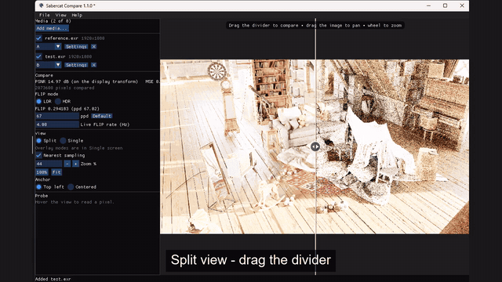
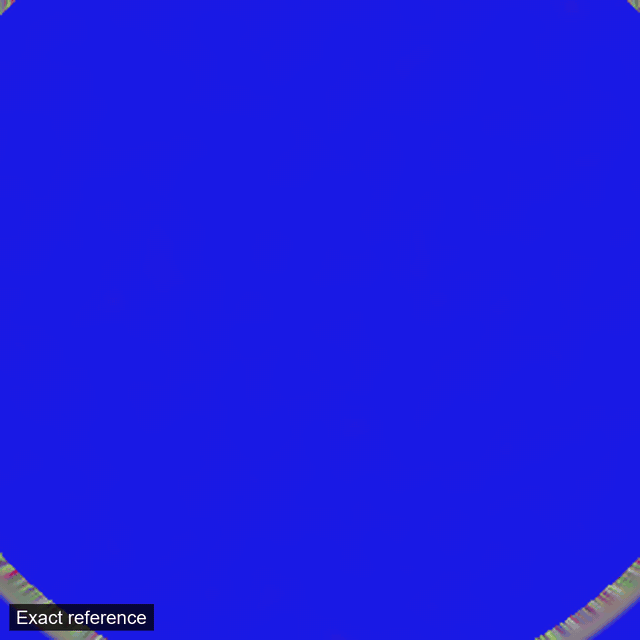
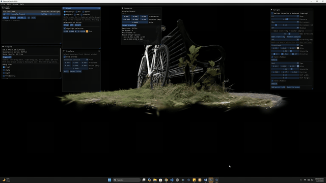

# Changelog

All notable changes to Sabercat are documented in this file.

The format follows [Keep a Changelog](https://keepachangelog.com/en/1.1.0/), and the project uses [Semantic Versioning](https://semver.org/spec/v2.0.0.html).

## [Unreleased]

## [1.1.0] - 2026-11-22

### Added

- Zip64 support in the project archive reader and writer (`src/renderer/zip_archive.cpp`). Projects over 4 GiB or with more than 65,534 entries now load and save. The writer uses Zip64 only when a classic zip cannot hold the project, so classic ZIP output is unchanged.
- `SPZWriter::write()` writes `.spz` files, the inverse of `SpzReader`. Container version 3 (gzip) is the default, and version 4 (zstd) is accepted. Positions outside about +-2048 are refused. Scale, opacity, DC color and SH are clamped, with one warning per write.
- Studio: **Export SPZ...** in the File menu and in the Type a Path submenu. It writes the visible layers as one merged SPZ.
- `Renderer::renderDebugView()` and `readDebugView()` render the debug views (alpha, depth, tile density, SH degree, final color) headless as RGBA float images, with `DebugViewScales` for the depth and density display scales. present() shows the same images.
- **Sabercat Compare** (`sabercat_compare`): compares two images or scenes. It is one executable that runs from the command line and will also open a window (GUI) when run with no arguments.
  - Command line: PSNR, FLIP and HDR-FLIP on the CPU. Inputs are PNG, JPEG, WebP, OpenEXR (`.exr`) and raw `.rgba32f` captures. It writes FLIP, HDR and difference maps as PNG, and a comparison report as JSON or CSV (`--report`). The exit codes are unchanged.
  - Window views: split and 2x2 views with synced zoom and pan, single, wipe, flicker and difference views, a pixel probe, and GPU PSNR and MSE. Vulkan is loaded only for the window, and `--selftest <dir>` runs its checks headless.
  - Splat scenes (`.ply`, `.spz`, `.splat`, `.ksplat`, `.sog`, `.gltf`, `.glb`) render beside images on one shared camera, with per-scene up-axis flip, antialias, SH cap and debug view, Depth, Alpha, Depth diff and Alpha diff maps, a depth readout in the probe, and the scene settings in project files.
  - LDR-FLIP is computed on the GPU. The window has a FLIP view, a ppd control (1 to 1000, default about 67), the FLIP mean in the metrics panel and the report, and a FLIP map export.
  - HDR-FLIP is computed on the GPU for Linear (EXR) pairs. It has an LDR/HDR toggle, a tone mapper, an auto or set exposure range and count, a progress bar with Cancel, an exposure map PNG export, and the HDR fields in the report.
  - MP4 (H.264) and WEBM (VP9) videos as sources, decoded with Media Foundation and converted from BT.709 on the GPU, with a transport bar (play, pause, step, seek, speed, loop), per-video trim, loop and time offset, and per-frame metrics.
  - Split with two sources is one image with a draggable divider (A left, B right), saved as `splitDivider` in the project.
  - Live scene updates: scenes render on every frame of a camera drag, metrics and LDR-FLIP update at up to 4 Hz (`flip.liveHz`) and once at rest, scene files reload when they change, and a render size change waits for the camera to rest.
  - `*.sabercat-compare` project files, exports (view PNG, difference map, report) and session logs: the window writes one log per run like the Viewer and Studio (`--log <path>` and `--no-log`); the command line writes none.
  - The apps package includes the comparer (`sabercat_compare`).
  
- Release packages are built in CI: a tag-triggered workflow (`.github/workflows/release.yml`) builds both zips on a clean hosted runner, writes `SHA256SUMS.txt` and publishes build-provenance attestations, so a download can be verified against its commit with `gh attestation verify`. `tools/release.ps1 -VerifyCi` cross-checks the CI build against the locally tested one. The GPU tests still run locally before a release.
- Repository checks in CI (`tools/check_repo.py`, `.github/workflows/repo-checks.yml`): every source file needs the copyright and SPDX header, secret scanning, and no absolute local paths.
- Opt-in sort modes for the Viewer and the library: `Stable`, `TileRayDepth`, `PixelWindow`, `Hybrid` and `Stochastic`, set with `Renderer::setSortSettings()` and `SortSettings` (`sabercat/sort_settings.h`). The default sort is unchanged, and Differentiable runs always use it.
  
- GPU stage timestamps in `ForwardPass` and `Renderer`: `setStageTimingEnabled()` and `lastStageTimings()`, off by default.
- Sorting study report in `docs/sorting-study.md`, with the `sabercat_sort_study` tool and the `sort_modes_test` checks.
- Viewer **Sort mode** panel for choosing the sort mode and its settings.
- Trainer example (`examples/trainer_example`): a small training loop that fits 512 Gaussians to renders of a synthetic torus with Adam, using only the C ABI (`backward_depth_view`, the image, depth and gradient views) and raw Vulkan kernels, with a finite-difference gradient check and the CTest entry `trainer_example`.
- Studio editing: box, sphere and rectangle selection of the active layer, with a highlight view. Transform of the selection (rigid and uniform scale, with a live preview), delete with compaction, duplicate, and undo and redo from the Edit menu (`Ctrl+Z`, `Ctrl+Y`) with a History window that lists every step and jumps to any of them. Adding, removing, moving, renaming and hiding or showing a layer are undoable steps, and so are Inspector transform edits.
  
- Studio merges the visible layers on the GPU (`Renderer::mergeLayersOnGpu()`). The host merge stays for the PLY and SPZ exports and as the fallback.
- Library additions for editing: `Renderer::mergeLayersOnGpu()`, `setSceneBounds()`, `setSelectionHighlight()` with `HighlightSettings`, `lastForwardCamera()`, `Renderer::editPass()` with `EditPass`, `SelectionMask`, the `edit_math.h` helpers, `mergedLayerBounds()`, `GaussianCloud::allocateGPU()` and `setBounds()`, and the `ShadowFrameStats` refit counters.

### Fixed

- `GaussianCloud::downloadFromGPU()` now also refreshes the normals, base color and roughness, and metallic streams, not only the core streams and visibility.

## [1.0.1] - 2026-11-03

### Fixed

- Associate presentation wait semaphores with acquired swapchain images instead
  of frame slots, preventing reuse while the presentation engine may still own
  them. Recreate these semaphores with the swapchain.
- Limit Viewer to 240 FPS by default to avoid unbounded mailbox rendering.
  `--max-fps 0` restores unlimited rendering; `--diagnostic-seconds` provides
  bounded frame-timing runs for investigating responsiveness problems.
- Free scoped Vulkan command buffers after completed submissions. Previously,
  rendering retained another command-buffer allocation each frame until the
  pool was destroyed, causing memory growth and increasing pool-reset work
  even with relighting disabled.

## [1.0.0] - 2026-10-28

First public release.

### Added

- **Rendering** (`Sabercat::sabercat`, C++20, Vulkan 1.3 compute, Slang shaders)
  - Forward splat rendering with antialiasing, spherical harmonics up to the scene's degree, and level-of-detail parameters.
  - Optional per-pixel depth output from the differentiable forward. `Renderer` takes a `DepthLayout` (`None`, `Depth`, `DepthCoverage` or `DepthCoverageFront`) at construction, read with `readDepth()` or the zero-copy `depthView()`.
  - `Renderer::clearScene()`, for applications that hide every layer.
- **Training support**
  - Backward pass with gradients for the Gaussian parameters, using 32-bit float atomics.
  - Depth gradients: the `Renderer::backward()` overloads take dL/d(depth) in the depth layout. Color-only backward is unchanged.
- **Lighting and relighting**
  - Directional, point and rectangle lights and an environment light, with deferred shading.
  - Ray-traced shadows and a visibility bake (requires ray query). The bake sizes its GPU submissions to a time budget (`VisibilityBakeSettings::targetSubmitMilliseconds`), so dense scenes stay clear of the driver timeout.
- **Scene formats**
  - Read: PLY (including the SuperSplat compressed layout), `.splat`, SPZ, `.ksplat`, SOG (`.sog` bundle or `meta.json`), glTF / GLB with `KHR_gaussian_splatting`, and the cloud-v1 directory format (`sabercat.cloud-v1`).
  - Write: PLY, GLB, and cloud-v1 with its relight sidecar (`sabercat.relight-v1`).
- **Projects**: layer transforms and project files (`.sabercat`, format `sabercat.project`). A project round-trips bit for bit.
- **Integration**
  - Owned or borrowed Vulkan device, so an application can share its own device and Gaussian buffers with the renderer.
  - C ABI (`Sabercat::sabercat_c`, `c_api.h`) with lifecycle functions, error reporting and `struct_size` versioning for input and output structs. The depth layout and depth gradients are available through it (`SabercatRendererDesc::depth_layout`, `sabercat_renderer_read_depth()`, `sabercat_renderer_get_depth_view()`, `sabercat_renderer_backward_depth()` and `sabercat_renderer_backward_depth_view()`).
  - CMake package: `find_package(Sabercat 1.0 CONFIG)` finds any 1.x release.
- **Applications**
  - Sabercat Viewer (`sabercat_viewer`): orbit camera, drag and drop, relighting, and an ImGui debug panel.
  - Sabercat Studio (`sabercat_studio`): layers, an inspector, project save and open, PLY and GLB export, and a `--selftest` mode.
  - Native Windows Open and Save dialogs in both apps. A cloud-v1 folder is opened by its `manifest.json`.
  - Per-user `.sabercat` file association for Studio (Help > Register `.sabercat` files), under HKEY_CURRENT_USER and without administrator rights. See [Studio](docs/studio.md#register-sabercat-files).
  - Session logs, and Help > About with the logo, the log folder and Copy system info.
  - App icons and version information on both executables.
- **Testing**
  - 30 GPU tests registered with CTest. They fail on any Vulkan validation message.
  - A forward-output regression test with stored checksums (`forward_regression_test`).
  - CPU unit tests for the apps' GPU-free logic, run in CI.
- **Packaging**: a Windows x64 release zip (`sabercat-<version>-win64.zip`) with a self-test, and an apps zip (`sabercat-<version>-win64-apps.zip`) for people who only want to run the apps.
- **Documentation and policies**: README, build, viewer, Studio, library, C ABI, consuming, formats and architecture guides. Apache-2.0 license, NOTICE, third-party notices, Code of Conduct, contributing guide and security policy.

### Security

- Release packages do not embed the build machine's source or build paths. The release script builds from a mapped drive and fails if a package contains them.

### Numerics

Numerical behavior is covered by `forward_regression_test`, which stores hashes of the forward output. Any change that alters a stored hash gets an entry under Numerics in the release that makes it.

[Unreleased]: https://github.com/KashyapRajpal/Sabercat/compare/v1.1.0...HEAD
[1.1.0]: https://github.com/KashyapRajpal/Sabercat/compare/v1.0.1...v1.1.0
[1.0.1]: https://github.com/KashyapRajpal/Sabercat/compare/v1.0.0...v1.0.1
[1.0.0]: https://github.com/KashyapRajpal/Sabercat/releases/tag/v1.0.0
