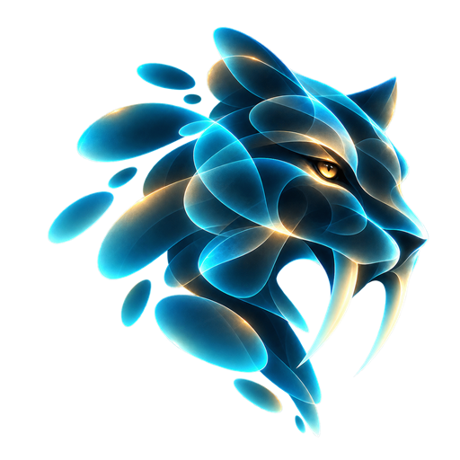
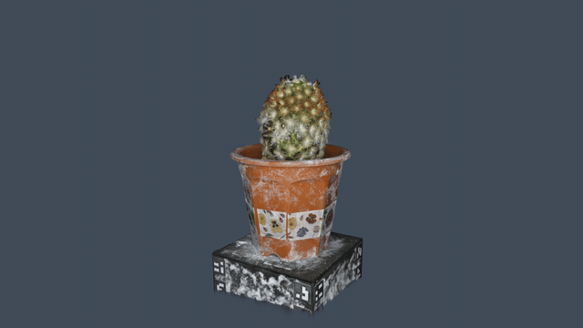

<p align="center"></p>

# Sabercat

Sabercat is a GPU engine for 3D Gaussian splats. It renders splat scenes in real time, computes gradients through the renderer for training, and relights scenes with ray-traced shadows cast by the splats themselves. No meshes are involved at any stage.

All GPU work runs as Vulkan 1.3 compute. There is no graphics pipeline and no render pass; the kernels are written in Slang and the host in C++20. Every stage is checked numerically against an independent CPU reference. Sabercat is built to be embedded: a trainer or an application can hand it its own Vulkan device and Gaussian buffers, and Sabercat renders and differentiates them in place, without copies.

It ships as:

- `Sabercat::sabercat`, a C++ library,
- `Sabercat::sabercat_c`, a C ABI DLL,
- `sabercat_viewer`, a scene viewer, and
- `sabercat_studio`, a layer editor with project files and PLY / GLB export.

Sabercat 1.0.0 is the current release. Windows 10/11 (x64) with Visual Studio 2022 is the tested platform.



The feature reel is rendered headless by [tools/make_demo.ps1](tools/make_demo.ps1) and `examples/demo_reel`. The scene is a cactus capture by steam_studio, published under CC0 at [note.com/steam_studio](https://note.com/steam_studio/n/ne9736d94f162). Only the renders are part of this repository; the scene itself is not redistributed. To make the reel yourself, pass any local scene with `-Scene`.

## Download

Prebuilt packages are on the [Releases page](https://github.com/KashyapRajpal/Sabercat/releases). No build or SDK is needed to run them.

| Package | For |
| --- | --- |
| [sabercat-1.0.0-win64-apps.zip](https://github.com/KashyapRajpal/Sabercat/releases/download/v1.0.0/sabercat-1.0.0-win64-apps.zip) | Trying Sabercat: the Viewer and Studio, ready to run |
| [sabercat-1.0.0-win64.zip](https://github.com/KashyapRajpal/Sabercat/releases/download/v1.0.0/sabercat-1.0.0-win64.zip) | Developers: the library, C ABI, headers and CMake package (see [docs/consuming.md](docs/consuming.md)) |

You need Windows 10 or 11 (x64) and a GPU driver with Vulkan 1.3. Unzip the apps package and run `bin\Release\sabercat_viewer.exe` or `bin\Release\sabercat_studio.exe`. `README.txt` in the zip covers how to run the apps and where to report problems.

## Features

| Area | What is included |
| --- | --- |
| Rendering | Forward splat rendering on Vulkan compute, antialiasing, spherical harmonics up to the scene's degree, level-of-detail parameters, optional per-pixel depth output (depth, coverage, front depth) |
| Training support | Backward pass that returns gradients for the Gaussian parameters (fp32 atomics), including gradients from a depth loss |
| Lighting | Relighting with directional, point and rectangle lights and an environment light, ray-traced shadows (needs ray query), visibility bake |
| Scene formats (read) | PLY, `.splat`, SPZ, `.ksplat`, SOG (`.sog` bundle or `meta.json`), glTF / GLB with `KHR_gaussian_splatting`, cloud-v1 directory |
| Scene formats (write) | PLY, GLB (glTF with `KHR_gaussian_splatting`), cloud-v1 directory |
| Projects | `.sabercat` project files with layers and layer transforms |
| Integration | Owned or borrowed Vulkan device, stable C ABI with `struct_size` versioning, CMake package |
| Applications | Viewer with orbit camera, drag and drop, and an ImGui debug panel; Studio with layers, inspector, project save / open, and export |

## Design highlights

The design decisions that shape the engine, with measured results. Timings are on an RTX 5070 Ti; [docs/architecture.md](docs/architecture.md) has the details.

- **One canonical data layout, end to end.** Every loader decodes into the same struct-of-arrays streams. The host strides equal the GPU strides, and one header shared by C++ and Slang defines them, so an upload is a plain copy. Covariance is never stored. Each frame derives it from scale and rotation, the same parameters an optimizer updates.
- **A GPU-driven frame in one submission.** The projection kernel counts the tile instances on the GPU. A one-thread kernel turns that count into indirect dispatch arguments for the 64-bit radix sort, the tile ranges and the rasterizer, so nothing is read back mid-frame. The forward pass on a 1.16M-Gaussian scene at 1280x720 went from 33-139 ms to 8.6 ms.
- **Ray tracing Gaussians, not triangles.** Each Gaussian is a procedural box in a hardware BVH. A ray-query walk multiplies transmittance at each Gaussian's peak density along the ray. The product does not depend on order, so nothing is sorted and no hit shaders are needed; GPUs with ray query alone are enough. Boxes are opacity-tight: they cover only the region where a Gaussian's alpha can reach 1/255. On a 3.5M-Gaussian scene that is 41% of the usual 3-sigma volume.
- **Exact shadows by default, and cheap when nothing changes.** One acceleration structure is shared and rebuilt only when the scene changes. A frame cache keyed on a hash of every input restores unchanged shadow results. Progressive accumulation converges to a result bit-identical to the full sample grid. On the 3.5M-Gaussian scene, an unchanged frame takes 43 ms (a full frame is 1.3-1.5 s, down from 2.7 s), and a converging frame about 0.1 s. Faster approximations are opt-in and named.
- **Relighting from the same splats.** The G-buffer pass reuses the color pass's sorted lists and splat evaluation, so its coverage matches the color alpha bit for bit. Deferred GGX shading supports directional, point and rectangular area lights and an SH environment. Ambient occlusion is real time: each Gaussian's visibility is baked into 16 SH coefficients. Bake rays start where they leave the Gaussian's own 3-sigma ellipsoid, so coplanar neighbors do not darken a flat surface.
- **Bring your own device and buffers.** Sabercat can own the Vulkan device, or borrow the application's device, queues and Gaussian buffers and work on them in place, under a documented single-queue synchronization contract. Studio itself runs on a borrowed device. The C ABI versions its structs with `struct_size`, so older callers keep working as the structs grow.
- **Lossless where it can be.**
  - `.sabercat` projects round-trip bit for bit, and each layer is a plain cloud-v1 directory other tools can read.
  - GLB export reloads untransformed layers bit for bit.
  - Layer transforms are restricted to translation, rotation and uniform scale. Under those, means, rotations, scales and spherical-harmonic bands transform without approximation.
  - Saves write a temporary file and rename it, so a failed save never corrupts a project.
- **Verified with numbers, not screenshots.** Every kernel has a C++ reference. The forward pass matches it to a worst color error of 1.2e-7 and a depth error of 0. Gradients agree to within fp32-atomic rounding. The 30 GPU tests fail on any Vulkan validation message.
- **Long GPU work stays responsive.** The visibility bake sizes its submissions to a time budget, so a dense scene never trips the Windows GPU timeout. The batches never drop below a floor, since a smaller batch would only add submissions without finishing sooner.

## Requirements

| Item | Requirement |
| --- | --- |
| OS | Windows 10 or 11, x64 |
| GPU | Vulkan 1.3. Compute workgroups of at least 256 invocations. 32-bit float atomics for the backward pass. Ray query is optional and enables ray-traced shadows and the visibility bake. |
| Compiler | Visual Studio 2022 (C++20) |
| CMake | 3.22 or newer |
| Vulkan SDK | 1.3 or newer (1.4.309.0 is tested). It provides `slangc` (build time only) and the validation layer (optional, run time only). |
| Network | Configure downloads zlib, libwebp, nlohmann_json and Dear ImGui with CMake `FetchContent`. GLFW is used from the system when installed, and fetched otherwise. GLM and VMA come from the Vulkan SDK when it ships them, and are fetched otherwise (`-DSABERCAT_FETCH_HEADER_DEPS=ON` always fetches). |

## Build

Clone with submodules. The SPZ reader uses the `external/spz` submodule.

```powershell
git clone --recurse-submodules https://github.com/KashyapRajpal/Sabercat.git
cd Sabercat
cmake -S . -B build -G "Visual Studio 17 2022" -A x64
cmake --build build --config Release --parallel
```

Build options (all default to ON when Sabercat is the top-level project):

| Option | Builds |
| --- | --- |
| `SABERCAT_BUILD_APPS` | `sabercat_viewer` and `sabercat_studio` |
| `SABERCAT_BUILD_EXAMPLES` | The programs in `examples/` |
| `SABERCAT_BUILD_TESTS` | The CTest tests |

The build is also described in [docs/building.md](docs/building.md).

## Quick start

Sabercat ships no sample scenes. Use any scene you have in a supported format: `.ply`, `.splat`, `.spz`, `.ksplat`, `.sog` or `meta.json`, `.gltf` / `.glb` with `KHR_gaussian_splatting`, or a cloud-v1 directory.

### 1. Open a scene in the viewer

```powershell
build\apps\viewer\Release\sabercat_viewer.exe path\to\scene.ply
```

You can also drag a scene file onto the window. Options:

| Flag | Effect |
| --- | --- |
| `--relight` | Start with relighting on |
| `--borrowed` | Use a Vulkan device that the app creates and hands to the renderer |
| `--validation` | Turn the Vulkan validation layer on in a Release build |
| `--no-validation` | Turn the validation layer off, including in a Debug build |

### 2. Open Sabercat Studio

```powershell
build\apps\studio\Release\sabercat_studio.exe path\to\scene.ply
```

Paths given on the command line are loaded at start-up. Studio takes the same `--validation` and `--no-validation` flags. The self-test runs without a window:

```powershell
build\apps\studio\Release\sabercat_studio.exe --selftest <outDir> [<scene>...]
```

## Library example

The core of [examples/hello_sabercat/main.cpp](examples/hello_sabercat/main.cpp), which loads a scene, renders one frame without a window and reads the image back:

```cpp
#include "sabercat/camera.h"
#include "sabercat/renderer.h"

sabercat::Renderer renderer(640, 480);
// No window extensions: a headless device. shaderDir is the compiled SPIR-V
// directory (SABERCAT_SHADER_DIR from the CMake package; see docs/consuming.md).
if (!renderer.initialize({}, /*enableValidation=*/false, shaderDir))
    return 1;

renderer.loadScene("scene.ply");                   // any supported format

const sabercat::SceneBounds bounds = renderer.sceneBounds();
sabercat::Camera camera;
camera.width = 640;
camera.height = 480;
camera.fx = camera.fy = 640.0f;
camera.cx = 319.5f;
camera.cy = 239.5f;
camera.cameraToWorld = glm::mat4(1.0f);            // look down -Z
camera.cameraToWorld[3] = glm::vec4(bounds.focusCenter + glm::vec3(0, 0, 3 * bounds.focusRadius), 1);
renderer.setCamera(camera);

renderer.forward();
std::vector<float> rgba = renderer.readImage();    // 640 x 480 RGBA floats
```

The full program writes the image as a PPM and builds as the target `sabercat_hello_sabercat`. [docs/library.md](docs/library.md) covers the rest of the API.

## Using Sabercat from another CMake project

Install the build, or build it next to your project, then find the package:

```cmake
find_package(Sabercat 1.0 CONFIG REQUIRED)   # any 1.x release
target_link_libraries(app PRIVATE Sabercat::sabercat)    # C++ API
# or: target_link_libraries(tool PRIVATE Sabercat::sabercat_c)  # C ABI
```

The prebuilt release zip and the `add_subdirectory` alternative are described in [docs/consuming.md](docs/consuming.md).

## Tests

The 30 GPU tests are the 29 `examples/*_test` programs plus `studio_selftest`. They are registered with CTest in `tests/integration`. They need a Vulkan 1.3 GPU, so run them on a local machine:

```powershell
ctest --test-dir build -C Release --output-on-failure
```

A test fails when its output contains a `[validation]` line. Continuous integration builds the project but does not run these tests, because hosted runners have no GPU.

## Documentation

| Document | Contents |
| --- | --- |
| [docs/building.md](docs/building.md) | Build options, dependencies, troubleshooting |
| [docs/viewer.md](docs/viewer.md) | Viewer controls and flags |
| [docs/studio.md](docs/studio.md) | Studio layers, project files, export |
| [docs/library.md](docs/library.md) | C++ API tour |
| [docs/c-api.md](docs/c-api.md) | C ABI reference |
| [docs/consuming.md](docs/consuming.md) | Using a release zip or the CMake package |
| [docs/formats.md](docs/formats.md) | Scene, project, cloud-v1 and relight file formats; export details |
| [docs/architecture.md](docs/architecture.md) | Module map, data layout, passes, synchronization |
| [docs/shaders.md](docs/shaders.md) | Shader layout and the Slang build |
| [docs/studio-design.md](docs/studio-design.md) | Studio design and plugin interface (proposed) |
| [docs/releasing.md](docs/releasing.md) | Maintainer guide for releases |
| [ROADMAP.md](ROADMAP.md) | Planned work |
| [PERFORMANCE.md](PERFORMANCE.md) | Measurements |
| [CHANGELOG.md](CHANGELOG.md) | Release history |

## Project layout

| Path | Contents |
| --- | --- |
| `include/sabercat/` | Public headers (library and C ABI) |
| `src/` | Library implementation |
| `shaders/` | Slang shaders |
| `apps/` | Viewer, Studio, and code they share |
| `examples/` | Example and test programs |
| `tests/` | CTest registration |
| `tools/` | Release, packaging and demo-reel scripts |
| `cmake/` | Package config and build helpers |
| `docs/` | Documentation |

## Contributing

See [CONTRIBUTING.md](CONTRIBUTING.md). Please follow the [Code of Conduct](CODE_OF_CONDUCT.md). Report security issues as described in [SECURITY.md](SECURITY.md).

## License

Sabercat is licensed under the Apache License, Version 2.0. See [LICENSE](LICENSE) and [NOTICE](NOTICE). Third-party components and their licenses are listed in [THIRD_PARTY_NOTICES.md](THIRD_PARTY_NOTICES.md). The Sabercat name and logo are not licensed under the Apache License (see [NOTICE](NOTICE)).

## Built with AI assistance

Sabercat was developed with the help of AI coding tools, under the author's direction. The author designed, reviewed and tested the code and is responsible for it.
