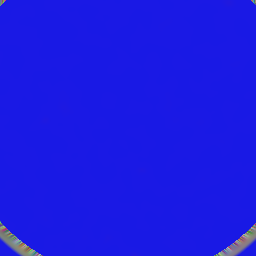
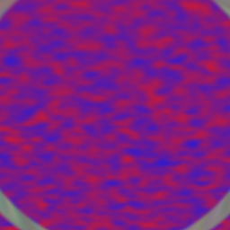
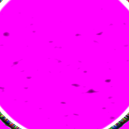
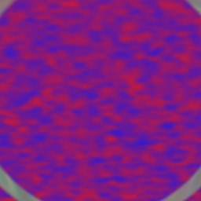
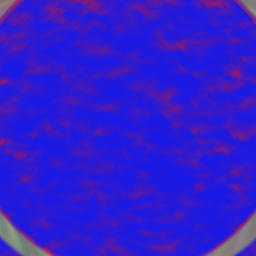
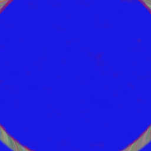
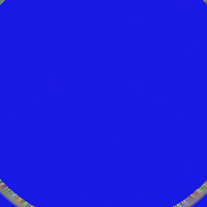

# Sort study

This document reports the sort study. It measures the opt-in sort modes
against the default per-tile order, on still images, along a camera orbit, and
for forward cost. The modes are described in
[architecture.md](architecture.md#sort-modes) and
[library.md](library.md#sort-modes). The Viewer exposes them in its Sort mode
list (see [viewer.md](viewer.md#sort-mode)). The measurements come from the
`sabercat_sort_study` harness in `examples/sort_study`.

## 1 Question

The question in ROADMAP.md is whether a stable depth sort, a per-pixel or
hybrid sort, or stochastic transparency can beat the per-tile center-depth sort
that the forward pass uses by default. Beating it means better image quality,
less popping while the camera moves, or both, at an acceptable forward cost.

The default does not change in 1.1. The alternatives are opt-in and available
in the Viewer only. No alternative is a candidate for the default; section 7
gives the criteria and the verdicts.

## 2 Methods

### 2.1 Modes

The labels below are used in every table in this document.

| Label | Mode | What changes | Extra memory |
| --- | --- | --- | --- |
| B0 | `Default` | Nothing. Each tile's list is sorted by the Gaussian's center depth. | None |
| S1 | `Stable` | Each Gaussian's depth key is a sticky log2-depth bucket with hysteresis, so near-tied depths keep their order between frames. | 4 B per Gaussian |
| T1 | `TileRayDepth` | The depth key is `t*`, the depth at which the Gaussian's density peaks along the ray through the tile center. | 48 B per Gaussian (ray-depth form) |
| P16, P32 | `PixelWindow` | Default tile keys. Each pixel blends its tile's candidates through a window of 16 or 32 entries sorted by `t*`. | 48 B per Gaussian |
| H8 | `Hybrid` | T1 tile keys, and a per-pixel window of 8 entries. | 48 B per Gaussian |
| ST4, ST8 | `Stochastic` | Order-independent stochastic coverage with 4 or 8 samples per pixel, averaged over frames by a resolve stage. | 48 B per Gaussian, 16 B per pixel of history, and a 16 KB noise table |

The extra memory column counts each mode's own buffers. The default path
allocates none of them.

### 2.2 Exact CPU reference

The quality reference is `cpu-exact`, rendered on the CPU. It takes the same
candidates that the GPU's tile lists contain for a camera: the same Gaussians
in the same tiles, with the same projected values. For each pixel it collects
every candidate that contributes, computes `t*` along the pixel's ray in double
precision, sorts the candidates by `(t*, Gaussian index)`, and blends them in
float with the same operation order as the GPU. Blending stops when
transmittance falls below 1e-4.

This is a per-pixel sort with no limit on the number of entries. It exists only
as the CPU reference. The GPU modes are compared against it, and it is the
reference for the stills, the popping score and the RMSE values.

### 2.3 Window model

PixelWindow and Hybrid keep at most K entries per pixel, sorted by
`(t*, Gaussian index)`. When a contributor arrives and the window is full, the
smallest entry is popped and blended, and the arrival is inserted. When the
tile list ends, the window is flushed in ascending order. K = 1 gives the list
order, which is the tile order. K at least the number of contributors gives the
exact ray-depth order. The CPU model and the GPU kernels follow the same rule.

### 2.4 Stochastic transparency

Each pixel keeps S samples (4 or 8). Each sample keeps the covered candidate
with the smallest `t*` seen so far, and that candidate's color.

1. For a contributing candidate g, sample s is covered when the candidate's
   alpha is greater than a threshold xi. The threshold is the pixel's
   blue-noise rank for that sample (from a 64x64 table), scaled to [0, 1), plus
   a per-frame offset and a hash of the Gaussian index, taken modulo 1.
2. A covered sample keeps the candidate with the smaller `t*`. The comparison
   is strict, so the first candidate in the list wins a tie.
3. There is no transmittance early-out, so the result does not depend on the
   list order.

The raw frame holds the premultiplied color averaged over the samples, and its
alpha is the coverage. The resolve stage blends it into a per-pixel history. While the camera is still, the weight is 1/k, a running
mean. When the camera moves, the history restarts (temporal mode 0), or in
the exponential mode (temporal mode 1) the frame weight is the EMA weight and the
static weight is max(1/k, EMA weight). The
stills use 32 static frames, and the usual metrics use the frame-32 image.

The first version of the threshold used only a per-Gaussian hash. Its
accumulated error stopped falling over 256 frames (rgb MAE against the exact
reference 0.0218 for both ST4 and ST8 after 256 frames, against 0.0226 and
0.0222 after 32), so that
version did not converge. Candidates at one pixel kept a fixed relative offset,
so their coverage stayed dependent. Changing the seed to depend on both the
frame and the sample fixed it: after 256 frames the MAE is 0.00394 for ST4 and
0.00279 for ST8 on the 256x192 test scene (sort_modes_test, check g2). The stochastic RMSE in section 5.7 falls with the number of frames.

### 2.5 Ray-depth form

T1, P16, P32, H8 and ST4/ST8 compute `t*` from a per-Gaussian form that holds
12 floats (48 B). It stores the columns of `P = S^-1 R^T W^T` and the vector
`u = P mu_cam`, so `t* = dot(u, d') / dot(d', d')` with `d' = P d`. An earlier
9-float form stored the inverse covariance B and `a = B mu`. That form
measured a worst relative error of 2.8e-4 in fp32, because `a` cancels. It was
replaced by the 12-float whitened form.

## 3 Setup

- Device: NVIDIA GeForce RTX 5070 Ti, driver 610.88.
- Build: Release.
- Scenes, by file name as the harness prints them:
  - `synthetic`: built in code by the harness, about 42,000 Gaussians.
  - `bonsai-7k.ply`: 1,157,141 Gaussians.
  - `racoonfamily.spz`, `bicycle-7k-mini.splat`, `hornedlizard.spz`: loaded
    from files. Their Gaussian counts are not recorded here.
- Sizes: 960x540 and 1920x1080. The second is called 1080p in the text.
- Stills: 8 per scene and mode, at azimuths 45 degrees apart (360 degrees
  divided by 8), at 15 degrees of elevation, with the same camera for every
  mode. The forward pass runs in Viewer mode.
- Temporal sequences: 120 frames, with a camera azimuth step of 0.5 degrees per
  frame, at 960x540. Only `synthetic` and `bonsai-7k.ply` were run this way.
- Cost: 200 frames after 20 warm-up frames. The reported values are the median
  and the 95th percentile (p95) of the host wall time of one forward, and the
  median of the GPU stage times from timestamp queries. The cost runs were done
  with an idle GPU and no concurrent builds. The quality and temporal runs ran
  alongside other GPU work on the same machine. That does not change their
  image metrics, and the timings in this document come only from the cost runs.

## 4 Metric definitions

- Display values. The metrics compare the display-referred sRGB values that
  the forward pass writes after blending, with alpha excluded.
- MAE. The mean over pixels and RGB channels of the absolute difference.
- PSNR. The peak value is 1. The mean squared error over RGB is accumulated in
  double, and PSNR is `10 log10(1 / MSE)`. It is infinite when the images are
  identical.
- FLIP. LDR-FLIP mean error at 67 pixels per degree, from the comparison core.
- Still metrics. Each still compares a mode with cpu-exact rendered from the
  default run's candidates at the same camera. The tables give the mean over the
  8 stills of each scene and size.
- Popping score. For each transition between consecutive frames, the mean over
  pixels and RGB of `max(0, |cur_m - prev_m| - |cur_ref - prev_ref|)`, where `m`
  is the mode and `ref` is cpu-exact. The score is the mean over the transitions
  of a 120-frame sequence, which has 119 transitions.
- Pop pixels. Per transition, the number of pixels where the mode changes by
  more than 0.05 (maximum over RGB) and the reference changes by less than 0.01
  (maximum over RGB). The value is the mean per transition.
- Near-tie swaps. Per transition, the number of pairs of Gaussians that share a
  tile in both frames, whose depths differ by less than 1e-3 relative, and whose
  order in the tile list changed. The value is the mean per transition. The
  stochastic modes have no list order, so they have no value.
- Cost. GPU total is the median forward total from timestamp queries. Ratio is
  the mode's GPU total divided by B0's GPU total for the same scene and size.
- Stochastic RMSE. The root-mean-square error over pixels and RGB channels,
  against cpu-exact at the same camera. f1, f8 and f32 are the errors after 1, 8
  and 32 static frames, each from a fresh history. During motion, the RMSE is
  computed for every frame of the path, the first included, and the mean over
  frames is reported.

## 5 Results

### 5.1 Still quality

Each cell is PSNR in dB, then FLIP, as the mean over the 8 stills of the scene.
Higher PSNR and lower FLIP are better.

960x540

| Scene | B0 | S1 | T1 | P16 | P32 | H8 | ST4 | ST8 |
| --- | --- | --- | --- | --- | --- | --- | --- | --- |
| bicycle-7k-mini.splat | 39.98 / 0.0190 | 39.98 / 0.0189 | 35.61 / 0.0215 | 47.59 / 0.0033 | 51.49 / 0.0016 | 39.59 / 0.0082 | 41.40 / 0.0103 | 44.43 / 0.0080 |
| bonsai-7k.ply | 42.51 / 0.0177 | 42.54 / 0.0177 | 36.52 / 0.0234 | 53.00 / 0.0021 | 56.97 / 0.0009 | 41.06 / 0.0092 | 37.67 / 0.0168 | 40.67 / 0.0130 |
| hornedlizard.spz | 39.92 / 0.0378 | 39.92 / 0.0379 | 38.23 / 0.0339 | 47.54 / 0.0009 | 47.89 / 0.0007 | 45.05 / 0.0034 | 38.76 / 0.0213 | 41.73 / 0.0165 |
| racoonfamily.spz | 34.76 / 0.0652 | 34.72 / 0.0653 | 38.90 / 0.0402 | 63.02 / 0.0010 | 77.12 / 0.0001 | 50.75 / 0.0025 | 36.73 / 0.0278 | 39.73 / 0.0215 |
| synthetic | 21.17 / 0.2402 | 20.89 / 0.2403 | 34.33 / 0.0108 | 28.25 / 0.1075 | 32.07 / 0.0273 | 39.04 / 0.0099 | 45.86 / 0.0041 | 48.65 / 0.0033 |

1920x1080

| Scene | B0 | S1 | T1 | P16 | P32 | H8 | ST4 | ST8 |
| --- | --- | --- | --- | --- | --- | --- | --- | --- |
| bicycle-7k-mini.splat | 40.87 / 0.0178 | 40.88 / 0.0178 | 40.30 / 0.0122 | 49.58 / 0.0023 | 54.02 / 0.0011 | 45.04 / 0.0031 | 41.56 / 0.0101 | 44.58 / 0.0078 |
| bonsai-7k.ply | 43.65 / 0.0170 | 43.65 / 0.0171 | 41.61 / 0.0134 | 57.81 / 0.0011 | 62.74 / 0.0004 | 47.73 / 0.0034 | 37.63 / 0.0167 | 40.62 / 0.0129 |
| hornedlizard.spz | 40.52 / 0.0372 | 40.49 / 0.0373 | 42.50 / 0.0213 | 50.53 / 0.0005 | 51.30 / 0.0004 | 48.77 / 0.0010 | 38.73 / 0.0211 | 41.71 / 0.0164 |
| racoonfamily.spz | 34.61 / 0.0653 | 34.57 / 0.0655 | 41.53 / 0.0277 | 63.57 / 0.0009 | 81.02 / 0.0001 | 54.16 / 0.0011 | 36.84 / 0.0274 | 39.85 / 0.0212 |
| synthetic | 21.26 / 0.2378 | 21.01 / 0.2379 | 38.08 / 0.0068 | 28.19 / 0.1039 | 31.95 / 0.0258 | 44.49 / 0.0054 | 45.96 / 0.0041 | 48.73 / 0.0032 |

Mean over the ten scene and size pairs, against B0. "Pairs better" counts
the pairs where the mode is better than B0, as the results file records them.

| Mode | Mean PSNR delta (dB) | Pairs with higher PSNR | Lowest PSNR delta (dB) | Mean FLIP delta | Pairs with lower FLIP |
| --- | --- | --- | --- | --- | --- |
| S1 | -0.06 | 4 of 10 | -0.28 | +0.0001 | 2 of 10 |
| T1 | +2.84 | 5 of 10 | -5.99 | -0.0544 | 8 of 10 |
| P16 | +12.98 | 10 of 10 | +6.93 | -0.0532 | 10 of 10 |
| P32 | +18.73 | 10 of 10 | +7.97 | -0.0697 | 10 of 10 |
| H8 | +9.64 | 8 of 10 | -1.45 | -0.0708 | 10 of 10 |
| ST4 | +4.19 | 6 of 10 | -6.02 | -0.0595 | 10 of 10 |
| ST8 | +7.14 | 8 of 10 | -3.03 | -0.0631 | 10 of 10 |

The lowest values for S1, P16 and P32 are the smallest per-pair differences in
table 5.1, computed from its cells. The other lowest values come from the
results file.

### 5.2 Temporal

Each sequence is 120 frames at 0.5 degrees per frame, at 960x540. Popping
values are relative to B0 in parentheses. Near-tie swaps are per transition.
Motion RMSE is the mean over frames for the stochastic modes.

synthetic

| Mode | Popping score | Pop pixels per frame | Near-tie swaps per frame | Motion RMSE (mean) |
| --- | --- | --- | --- | --- |
| B0 | 0.003538 (1.00x) | 7213.8 | 425,065 | n/a |
| S1 | 0.005259 (1.49x) | 13891.2 | 842,292 | n/a |
| T1 | 0.000523 (0.15x) | 1056.2 | 37,205 | n/a |
| P16 | 0.003005 (0.85x) | 6082.7 | 425,065 | n/a |
| P32 | 0.000715 (0.20x) | 2118.2 | 425,065 | n/a |
| H8 | 0.000505 (0.14x) | 1054.9 | 37,205 | n/a |
| ST4 | 0.007205 (2.04x) | 9785.3 | n/a | 0.0318 |
| ST8 | 0.005081 (1.44x) | 11282.9 | n/a | 0.0225 |

bonsai-7k.ply

| Mode | Popping score | Pop pixels per frame | Near-tie swaps per frame | Motion RMSE (mean) |
| --- | --- | --- | --- | --- |
| B0 | 0.001154 (1.00x) | 151.2 | 24,593,975 | n/a |
| S1 | 0.001219 (1.06x) | 206.9 | 166,095,270 | n/a |
| T1 | 0.002552 (2.21x) | 1347.2 | 8,791,830 | n/a |
| P16 | 0.000221 (0.19x) | 11.8 | 24,593,975 | n/a |
| P32 | 0.000074 (0.06x) | 3.0 | 24,593,975 | n/a |
| H8 | 0.001242 (1.08x) | 543.0 | 8,791,830 | n/a |
| ST4 | 0.039767 (34.47x) | 43474.9 | n/a | 0.0697 |
| ST8 | 0.027006 (23.41x) | 35452.4 | n/a | 0.0493 |

The window modes keep the list order of their tile keys, so their near-tie
count equals that of B0 (P16 and P32) or of T1 (H8).

### 5.3 Cost

GPU total is the median forward total in milliseconds, with the ratio to B0 in
parentheses. The ratios are the ones recorded in the results file.

960x540

| Scene | B0 | S1 | T1 | P16 | P32 | H8 | ST4 | ST8 |
| --- | --- | --- | --- | --- | --- | --- | --- | --- |
| bicycle-7k-mini.splat | 3.051 (1.00x) | 3.058 (1.00x) | 3.535 (1.16x) | 15.634 (5.12x) | 31.910 (10.46x) | 5.857 (1.92x) | 3.422 (1.12x) | 4.429 (1.45x) |
| bonsai-7k.ply | 8.305 (1.00x) | 8.331 (1.00x) | 8.875 (1.07x) | 28.914 (3.48x) | 57.413 (6.91x) | 12.353 (1.49x) | 14.733 (1.77x) | 20.644 (2.49x) |
| hornedlizard.spz | 16.594 (1.00x) | 16.380 (0.99x) | 16.521 (1.00x) | 47.669 (2.87x) | 102.705 (6.19x) | 20.843 (1.26x) | 45.877 (2.76x) | 70.442 (4.25x) |
| racoonfamily.spz | 8.010 (1.00x) | 8.017 (1.00x) | 8.456 (1.06x) | 51.334 (6.41x) | 120.489 (15.04x) | 19.611 (2.45x) | 11.006 (1.37x) | 14.439 (1.80x) |
| synthetic | 0.742 (1.00x) | 0.752 (1.01x) | 0.817 (1.10x) | 6.514 (8.78x) | 15.292 (20.61x) | 1.790 (2.41x) | 1.036 (1.40x) | 1.585 (2.14x) |

1920x1080

| Scene | B0 | S1 | T1 | P16 | P32 | H8 | ST4 | ST8 |
| --- | --- | --- | --- | --- | --- | --- | --- | --- |
| bicycle-7k-mini.splat | 5.349 (1.00x) | 5.396 (1.01x) | 6.060 (1.13x) | 23.138 (4.33x) | 42.291 (7.91x) | 9.855 (1.84x) | 5.711 (1.07x) | 8.089 (1.51x) |
| bonsai-7k.ply | 5.782 (1.00x) | 5.872 (1.02x) | 6.509 (1.13x) | 31.131 (5.38x) | 61.509 (10.64x) | 10.661 (1.84x) | 8.801 (1.52x) | 12.038 (2.08x) |
| hornedlizard.spz | 8.575 (1.00x) | 8.572 (1.00x) | 8.951 (1.04x) | 32.107 (3.74x) | 72.304 (8.43x) | 12.648 (1.47x) | 20.687 (2.41x) | 30.523 (3.56x) |
| racoonfamily.spz | 5.031 (1.00x) | 5.030 (1.00x) | 5.570 (1.11x) | 40.161 (7.98x) | 86.762 (17.25x) | 12.045 (2.39x) | 6.507 (1.29x) | 8.897 (1.77x) |
| synthetic | 1.755 (1.00x) | 1.790 (1.02x) | 1.983 (1.13x) | 15.432 (8.79x) | 35.054 (19.97x) | 3.872 (2.21x) | 2.546 (1.45x) | 4.091 (2.33x) |

Wall time is the host time per forward, median with p95 in parentheses, in
milliseconds.

960x540

| Scene | B0 | S1 | T1 | P16 | P32 | H8 | ST4 | ST8 |
| --- | --- | --- | --- | --- | --- | --- | --- | --- |
| bicycle-7k-mini.splat | 3.477 (3.689) | 3.492 (3.661) | 3.988 (4.211) | 16.194 (17.327) | 32.548 (36.325) | 6.352 (6.714) | 3.783 (3.981) | 4.801 (5.113) |
| bonsai-7k.ply | 8.851 (10.062) | 8.927 (10.075) | 9.459 (10.582) | 29.696 (33.126) | 58.081 (69.811) | 12.999 (14.507) | 15.242 (16.210) | 21.213 (22.788) |
| hornedlizard.spz | 17.151 (18.681) | 16.867 (18.496) | 17.069 (18.684) | 48.374 (53.363) | 103.402 (130.341) | 21.395 (23.116) | 46.323 (52.161) | 71.082 (79.967) |
| racoonfamily.spz | 8.413 (8.957) | 8.533 (8.930) | 8.948 (9.465) | 52.025 (62.621) | 121.092 (158.006) | 20.197 (22.004) | 11.350 (11.983) | 14.863 (15.647) |
| synthetic | 1.020 (1.245) | 1.047 (1.256) | 1.127 (1.444) | 7.122 (9.010) | 15.936 (20.843) | 2.276 (2.639) | 1.340 (1.714) | 1.949 (2.227) |

1920x1080

| Scene | B0 | S1 | T1 | P16 | P32 | H8 | ST4 | ST8 |
| --- | --- | --- | --- | --- | --- | --- | --- | --- |
| bicycle-7k-mini.splat | 5.738 (6.063) | 5.872 (6.200) | 6.558 (6.849) | 23.729 (25.496) | 42.991 (48.827) | 10.313 (10.980) | 6.105 (6.494) | 8.501 (9.075) |
| bonsai-7k.ply | 6.243 (6.781) | 6.363 (6.949) | 6.931 (7.427) | 31.694 (36.459) | 62.285 (76.278) | 11.159 (12.757) | 9.228 (9.812) | 12.450 (13.559) |
| hornedlizard.spz | 9.059 (9.977) | 9.054 (10.057) | 9.431 (10.451) | 32.820 (38.330) | 73.020 (90.686) | 13.121 (14.113) | 21.144 (25.487) | 31.053 (38.059) |
| racoonfamily.spz | 5.489 (6.169) | 5.526 (6.115) | 6.072 (6.694) | 40.886 (48.606) | 87.514 (110.862) | 12.536 (14.584) | 6.851 (7.717) | 9.390 (10.285) |
| synthetic | 2.205 (2.394) | 2.244 (2.437) | 2.452 (2.674) | 16.092 (19.728) | 35.873 (45.223) | 4.390 (5.029) | 2.924 (3.281) | 4.500 (5.136) |

Stage breakdown for bonsai-7k.ply, in milliseconds. The results file records
these four stages and the total. Project, scan, binning and ranges are not in
the file, so the stages listed do not sum to the total.

960x540

| Mode | sortKeys | sort | rasterize | resolve | total |
| --- | --- | --- | --- | --- | --- |
| B0 | 0.000 | 1.394 | 6.213 | 0.0001 | 8.305 |
| S1 | 0.119 | 1.289 | 6.229 | 0.0001 | 8.331 |
| T1 | 0.373 | 1.621 | 6.143 | 0.0001 | 8.875 |
| P16 | 0.258 | 1.396 | 26.516 | 0.0001 | 28.914 |
| P32 | 0.258 | 1.394 | 54.998 | 0.0001 | 57.413 |
| H8 | 0.373 | 1.623 | 9.602 | 0.0001 | 12.353 |
| ST4 | 0.258 | 0.666 | 13.072 | 0.0113 | 14.733 |
| ST8 | 0.258 | 0.666 | 18.974 | 0.0113 | 20.644 |

1920x1080

| Mode | sortKeys | sort | rasterize | resolve | total |
| --- | --- | --- | --- | --- | --- |
| B0 | 0.000 | 1.791 | 3.214 | 0.0001 | 5.782 |
| S1 | 0.131 | 1.752 | 3.216 | 0.0001 | 5.872 |
| T1 | 0.397 | 2.123 | 3.217 | 0.0001 | 6.509 |
| P16 | 0.258 | 1.791 | 28.340 | 0.0001 | 31.131 |
| P32 | 0.258 | 1.791 | 58.711 | 0.0001 | 61.509 |
| H8 | 0.397 | 2.127 | 7.328 | 0.0001 | 10.661 |
| ST4 | 0.258 | 0.938 | 6.772 | 0.0615 | 8.801 |
| ST8 | 0.258 | 0.938 | 10.000 | 0.0646 | 12.038 |

### 5.4 Memory

Extra memory is the allocated size of the mode's own buffers, in MiB, from
`ForwardPass::extraBufferBytes()`. The ray-depth form is shared by T1, P16,
P32 and H8, so those four have the same value. Stochastic values include the
per-pixel history and the noise table.

| Scene | Size | S1 | T1, P16, P32, H8 | ST4, ST8 |
| --- | --- | --- | --- | --- |
| bicycle-7k-mini.splat | 960x540 | 2.17 | 25.99 | 33.91 |
| bicycle-7k-mini.splat | 1920x1080 | 2.17 | 25.99 | 57.64 |
| bonsai-7k.ply | 960x540 | 4.41 | 52.97 | 60.90 |
| bonsai-7k.ply | 1920x1080 | 4.41 | 52.97 | 84.63 |
| hornedlizard.spz | 960x540 | 3.00 | 35.99 | 43.92 |
| hornedlizard.spz | 1920x1080 | 3.00 | 35.99 | 67.65 |
| racoonfamily.spz | 960x540 | 3.56 | 42.69 | 50.62 |
| racoonfamily.spz | 1920x1080 | 3.56 | 42.69 | 74.35 |
| synthetic | 960x540 | 0.16 | 1.92 | 9.85 |
| synthetic | 1920x1080 | 0.16 | 1.92 | 33.58 |

### 5.5 Cost at 1080p versus 540p

The rasterize stage of bonsai-7k.ply, racoonfamily.spz and hornedlizard.spz is
about 2x faster at 1920x1080 than at 960x540, although 1080p has more pixels
and more total batches. The table shows the tile statistics of the default
sort at the first still's camera. The last column is computed from the two
columns to its left.

| Scene | Size | Total batches | Longest tile walk (batches) | Rasterize (ms) | Rasterize ms per longest-walk batch (us) |
| --- | --- | --- | --- | --- | --- |
| bonsai-7k.ply | 960x540 | 9,144 | 400 | 6.213 | 15.5 |
| bonsai-7k.ply | 1920x1080 | 15,596 | 166 | 3.214 | 19.4 |
| racoonfamily.spz | 960x540 | 7,223 | 255 | 6.364 | 25.0 |
| racoonfamily.spz | 1920x1080 | 13,504 | 85 | 3.109 | 36.6 |
| hornedlizard.spz | 960x540 | 6,025 | 737 | 15.254 | 20.7 |
| hornedlizard.spz | 1920x1080 | 12,283 | 318 | 7.033 | 22.1 |
| bicycle-7k-mini.splat | 960x540 | 7,576 | 70 | 1.422 | 20.3 |
| bicycle-7k-mini.splat | 1920x1080 | 16,576 | 37 | 2.119 | 57.3 |

For bonsai, racoonfamily and hornedlizard, the rasterize time is 1.93x, 2.05x
and 2.17x lower at 1080p. The longest tile walk shrinks in the same runs, and
the rasterize time follows it. The per-batch figure is not constant: it is
15.5 to 36.6 us on these three scenes and 20.3 and 57.3 us on bicycle. The
relation is therefore a rough one, not a fixed cost per batch.

On bicycle-7k-mini.splat the longest walk is short at both sizes, 70 and 37
batches. There the 1080p run is slower, 2.12 ms against 1.42 ms, because the
total batch count rises from 7,576 to 16,576. This is consistent with total
work dominating when the longest walk is short.

This is a measured correlation between the rasterize time and the longest tile
walk. It is not a proven cause. The obvious next step is tile-level load
balancing, which splits long tile lists across workgroups. It was not tried.

### 5.6 Images

The crops are the 256x256 center crop of still 0 (azimuth 0 degrees) of the
synthetic scene at 960x540. The difference image multiplies the absolute
difference by 4 for display.

cpu-exact reference: the exact per-pixel ray-depth order, on the CPU.

B0: the shipped per-tile center-depth sort.

Absolute difference between B0 and the reference, times 4.

S1: sticky depth buckets with hysteresis.

T1: tile-center ray-depth keys.

P16: per-pixel window of 16 entries.

P32: per-pixel window of 32 entries.

H8: T1 keys with a per-pixel window of 8 entries.

ST4: stochastic coverage with 4 samples, after 32 static frames.

ST8: stochastic coverage with 8 samples, after 32 static frames.

### 5.7 Findings

- The synthetic scene is a worst case for the default sort. Its B0 PSNR is
  21.17 dB at 960x540, against 34.76 to 42.51 dB for the real scenes at the
  same size. Its B0 FLIP is 0.2402, against 0.0177 to 0.0652 on the real scenes
  at 960x540.
- Hybrid beats T1 alone on every real scene at both sizes, in PSNR and in
  FLIP.
- The window modes win on quality, and their cost grows with K. P32 has a higher
  PSNR than P16 on all ten pairs. Its GPU total at 1080p on bonsai is 10.64x
  B0, against 5.38x for P16. The rasterize time doubles from K = 16 to K = 32,
  from 28.340 ms to 58.711 ms at 1080p on bonsai.
- S1 keeps order between frames, but its near-tie swap count rises. On bonsai the
  count per transition goes from 24,593,975 to 166,095,270, and on the synthetic
  scene from 425,065 to 842,292. The explanation the design gives is that ties
  inside a bucket fall back to Gaussian-index order. That reading is not
  measured separately.
- The stochastic modes converge when the camera is still, and they are noisy
  while it moves. The stills show the RMSE falling with frames. The table below
  gives the values.

Stochastic RMSE against cpu-exact after 1, 8 and 32 static frames, from the
stills (display values):

| Scene | Size | ST4 f1 / f8 / f32 | ST8 f1 / f8 / f32 |
| --- | --- | --- | --- |
| bicycle-7k-mini.splat | 960x540 | 0.0483 / 0.0171 / 0.0085 | 0.0342 / 0.0121 / 0.0060 |
| bicycle-7k-mini.splat | 1920x1080 | 0.0475 / 0.0168 / 0.0084 | 0.0336 / 0.0119 / 0.0059 |
| bonsai-7k.ply | 960x540 | 0.0745 / 0.0263 / 0.0131 | 0.0526 / 0.0186 / 0.0093 |
| bonsai-7k.ply | 1920x1080 | 0.0749 / 0.0264 / 0.0132 | 0.0530 / 0.0187 / 0.0094 |
| hornedlizard.spz | 960x540 | 0.0658 / 0.0233 / 0.0116 | 0.0465 / 0.0165 / 0.0083 |
| hornedlizard.spz | 1920x1080 | 0.0660 / 0.0233 / 0.0116 | 0.0467 / 0.0165 / 0.0083 |
| racoonfamily.spz | 960x540 | 0.0825 / 0.0293 / 0.0146 | 0.0583 / 0.0207 / 0.0103 |
| racoonfamily.spz | 1920x1080 | 0.0815 / 0.0289 / 0.0144 | 0.0577 / 0.0204 / 0.0102 |
| synthetic | 960x540 | 0.0284 / 0.0101 / 0.0052 | 0.0201 / 0.0072 / 0.0038 |
| synthetic | 1920x1080 | 0.0283 / 0.0101 / 0.0052 | 0.0200 / 0.0072 / 0.0038 |

The ratio f1 to f8 for ST4 on bicycle at 1080p is 2.8, and f8 to f32 is 2.0.
Those ratios match the expected fall of 1/sqrt(N) for N accumulated frames.
On the four real scenes, the stochastic modes have a lower PSNR than P16 in
every still, while their FLIP is lower than B0's on every pair.

## 6 What was not measured, and why

- Reprojection for stochastic transparency. It is a stretch goal and was not
  built. The history is not moved to new pixel positions. With motion, it is
  restarted or blended in place.
- Other GPUs and drivers. Every number here comes from one device and one
  driver.
- Relit scenes. PixelWindow, Hybrid and Stochastic are refused with lighting on,
  so the study did not measure lit scenes.
- An exhaustive parameter sweep. S1 ran at its defaults, 1024 buckets per octave
  and hysteresis 1.0. K was 8, 16 and 32 only, and the stochastic sample counts
  were 4 and 8 only. The EMA weight was not varied, and the stochastic runs used
  the static accumulation mode with 32 frames.
- Temporal sequences on the three other local scenes. Only synthetic and
  bonsai-7k.ply have a temporal sequence.
- Backward and training use. A Differentiable run always uses the default sort,
  so the study says nothing about those paths.
- Debug timings. All timings are from Release builds.
- Kernel tuning. The kernels are not tuned. K = 32 uses dynamically indexed
  per-thread arrays, which is a possible cost in table 5.3.
- An unbounded per-pixel sort on the GPU. It exists only as the CPU reference.

## 7 Recommendation

A mode is a candidate for the default in a later release only if all four
criteria hold. The criteria come from the plan for this study (section 3.9, written
on 2026-11-23, before any sort mode was measured; the first sort-mode measurements
were taken later the same day). The plan's wording for criteria 2 and 3 did not
name a scope; this study reads them as holding on every scene and size.

1. Popping score at most 0.5x B0 on both temporal sequences.
2. Still PSNR at least B0's minus 0.1 dB, on every scene and size.
3. Still FLIP at most B0's, on every scene and size.
4. Forward cost at 1920x1080 on bonsai-7k.ply at most 1.25x B0 (GPU total).

### 7.1 Verdict table

The table gives the values that decide each criterion.

| Mode | 1. Popping, bonsai / synthetic | 2. PSNR vs B0 (lowest pair) | 3. FLIP vs B0 | 4. Cost, bonsai 1080p | Verdict |
| --- | --- | --- | --- | --- | --- |
| S1 | 1.06x / 1.49x: fail | fail, -0.28 dB | fail | 1.02x: pass | not recommended |
| T1 | 2.21x / 0.15x: fail | fail, -5.99 dB | fail | 1.13x: pass | keep opt-in |
| P16 | 0.19x / 0.85x: fail | pass, +6.93 dB | pass | 5.38x: fail | keep opt-in |
| P32 | 0.06x / 0.20x: pass | pass, +7.97 dB | pass | 10.64x: fail | keep opt-in |
| H8 | 1.08x / 0.14x: fail | fail, -1.45 dB | pass | 1.84x: fail | keep opt-in |
| ST4 | 34.47x / 2.04x: fail | fail, -6.02 dB | pass | 1.52x: fail | keep opt-in |
| ST8 | 23.41x / 1.44x: fail | fail, -3.03 dB | pass | 2.08x: fail | keep opt-in |

P32 meets the three quality criteria and fails only the cost criterion. No mode
meets all four criteria.

### 7.2 Verdict rule

The plan fixed the four criteria above but gave no rule for modes that fail them.
The rule here was written after the first measurements were seen. A mode is
marked not recommended when it is worse than B0 on popping on both temporal
sequences, and its mean PSNR and FLIP deltas over the ten scene and size pairs
show no benefit. Any other mode is kept as opt-in. A not recommended mode is not
removed: it stays available as an opt-in mode.

### 7.3 Verdicts

- S1 Stable: not recommended (it stays available as an opt-in mode). Its popping is 1.06x and 1.49x of B0, its near-tie swaps rise
  6.8x on bonsai, and its mean PSNR delta is -0.06 dB with a mean FLIP delta of
  +0.0001. It is a negative result: the stable keys do not reduce popping in
  these runs.
- T1 TileRayDepth: keep opt-in. It is cheap, at 1.00x to 1.16x of B0 across the
  ten pairs, and its FLIP is lower on 8 of 10 pairs. Its PSNR loses up to
  5.99 dB, and its bonsai popping is 2.21x of B0.
- P16 PixelWindow: keep opt-in. It has a mean PSNR gain of 12.98 dB and a lower
  FLIP on 10 of 10 pairs. Its cost is 3.48x to 5.38x of B0 on bonsai, and it
  fails the synthetic popping criterion at 0.85x.
- P32 PixelWindow: keep opt-in. It meets the three quality criteria. It fails the
  cost criterion at 10.64x.
- H8 Hybrid: keep opt-in. It has a mean PSNR gain of 9.64 dB and a lower FLIP on
  10 of 10 pairs. Its cost is 1.49x at 960x540 and 1.84x at 1080p on bonsai. It
  fails the bonsai popping criterion at 1.08x, and two pairs lose PSNR, with the
  lowest at -1.45 dB.
- ST4 and ST8 Stochastic: keep opt-in, as a mode that converges when the camera
  is still. Their FLIP is lower on 10 of 10 pairs. During motion their popping is
  34.47x and 23.41x of B0 on bonsai, because every frame draws a fresh sample set.
  Their cost is 1.52x and 2.08x at 1080p on bonsai.

The default stays B0 in 1.1. The sort modes stay opt-in and available in the
Viewer only.

## 8 How to reproduce

The harness is `sabercat_sort_study`. Replace the placeholders with a scene
file, a scene name, or an output directory. The mode list is the same in every
run:

    default,stable,tile-ray-depth,pixel-window16,pixel-window32,hybrid,stochastic4,stochastic8

Cost, with an idle GPU:

    sabercat_sort_study --scene <scene file> --scene <scene file> --out <output directory> --modes <mode list> --sizes 960x540,1920x1080 --no-stills --no-temporal --cost-frames 200

Quality stills, 8 per scene and size:

    sabercat_sort_study --scene <scene file> --out <output directory> --modes <mode list> --sizes 960x540,1920x1080 --stills 8 --no-temporal --no-cost

Temporal, on the synthetic scene and on bonsai-7k.ply at 960x540:

    sabercat_sort_study --scene synthetic --scene <bonsai-7k.ply file> --out <output directory> --modes <mode list> --sizes 960x540 --frames 120 --no-stills --no-cost

Tile statistics, which run on their own:

    sabercat_sort_study --scene <scene file> --out <output directory> --tile-stats --no-stills --no-temporal --no-cost --modes default

Outputs go to the output directory. `results.json` and `results.csv` hold every
metric. The synthetic scene's still 0 writes 256x256 center crops there as PNG
files: `<mode>_<size>.png` for each mode, and `ref_exact_<size>.png` and
`abs_diff_default_<size>.png`. The crops and FLIP need the comparison core,
which the build includes only when it is present. Without it the crops are
skipped and FLIP is NaN. `--no-flip` turns FLIP off. `--smoke` runs a short
check with small settings.

The checks for the sort modes are in `sabercat_sort_modes_test`, which compares
the GPU modes with the CPU models and checks that the default path is unchanged.

The tool runs only on Windows, because FLIP comes from the comparison core,
which links the Windows imaging APIs.
</content>
